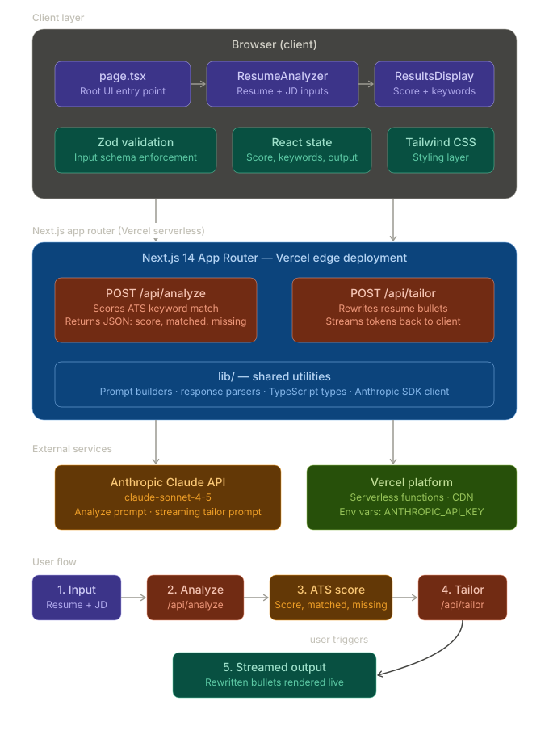

# Resume Tailor

[](https://github.com/nsrathore/resume-tailor/actions/workflows/ci.yml)

> AI-powered resume optimizer that scores your ATS match and rewrites your bullets to land more interviews.

**[Live demo →](https://resume-tailor.nikkirathore.com)** &nbsp;·&nbsp; Next.js 14 · TypeScript · Claude API · Zod · Upstash Redis · Vercel

---

## What it does

Paste your resume and a job description. Resume Tailor:

1. **Scores your ATS match** (0–100) based on keyword overlap
2. **Identifies missing keywords** the job description requires but your resume lacks
3. **Rewrites your bullets** in real-time using Claude to naturally incorporate those keywords — without inventing facts

---

## Tech stack

| Layer | Technology |
|-------|-----------|
| Framework | Next.js 14 (App Router) |
| Language | TypeScript |
| AI | Anthropic Claude claude-sonnet-4-5 |
| Styling | Tailwind CSS |
| Validation | Zod |
| Deployment | Vercel |

## Architecture



```
User Input (Resume + JD)
        │
        ▼
POST /api/analyze  ──► Claude API ──► JSON { score, matched, missing }
        │
        ▼
POST /api/tailor   ──► Claude API ──► Streaming rewritten bullets
```

## Guardrails

A public LLM demo needs cost and abuse controls, so both endpoints enforce:

- **Per-IP rate limiting** with an Upstash Redis sliding window (`RATE_LIMIT_PER_DAY`, default 5).
- **Input caps** of 8,000 characters per field and bounded `max_tokens` on every Claude call.
- **Schema validation with Zod** on both the request and Claude's JSON output, so malformed model output is rejected instead of rendered.
- **A kill switch** (`DEMO_ENABLED=false`) to pause the public demo without a redeploy.

## Running locally

```bash
# 1. Clone the repo
git clone https://github.com/nsrathore/resume-tailor
cd resume-tailor

# 2. Install dependencies
npm install

# 3. Set up environment variables
cp .env.example .env.local
# Add your Anthropic API key (and optionally Upstash credentials) to .env.local

# 4. Start the dev server
npm run dev
```

Open [http://localhost:3000](http://localhost:3000) or appropriate port.

## Get an API key

Sign up at [console.anthropic.com](https://console.anthropic.com) to get your `ANTHROPIC_API_KEY`.

## Deploying to Vercel

```bash
npx vercel --prod
```

Add the variables from `.env.example` in your Vercel project settings.

---

Built by [Nikhilendra Rathore](https://nikkirathore.com) · [LinkedIn](https://linkedin.com/in/nikhilendrasrathore)
